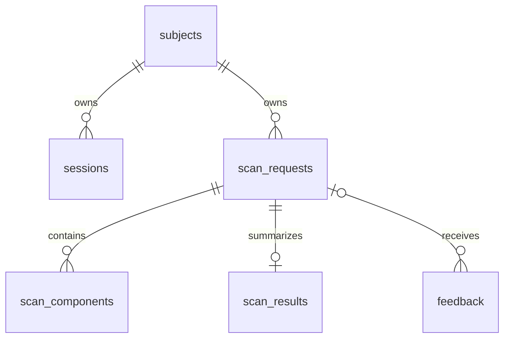
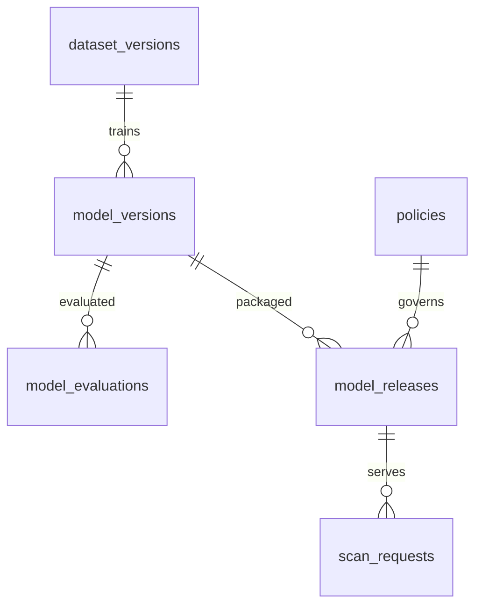
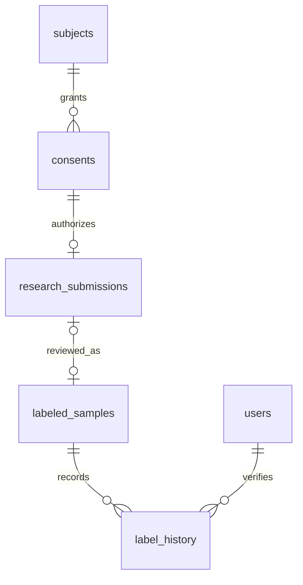

# G0 — ERD và thiết kế PostgreSQL

Baseline: PostgreSQL 17; nguồn DDL là `database/design/g0-schema.sql`. Đây là thiết kế
để triển khai migration sau, không tự thay đổi database `phishing_detector` đang chạy.
Data dictionary được sinh từ catalog sau khi thực thi DDL trong database kiểm tra cô lập.

## 1. Các nhóm quan hệ

### Chủ sở hữu và kết quả

Mỗi scan hoàn tất phải có đúng một scan_results trong cùng transaction. DDL ngăn
nhiều kết quả nhưng điều kiện “phải có một” do transaction nghiệp vụ bảo đảm. Một
MESSAGE có 1 thành phần TEXT và tối đa 10 thành phần URL; QR_URL dùng một URL component.
Một mô hình gắn với component, không gắn trực tiếp toàn bộ tin nhắn.

### Mô hình và đánh giá

Release có url_model_id và message_model_id tùy scope; FK kép kiểm đúng task.
URL_ONLY cho phép phát hành URL ở G1 mà chưa có mô hình SMS. MULTI_INPUT bắt buộc có
message model. Mỗi release trỏ snapshot BRANDS, PSL, RULES và policy, không đọc cấu hình
“mới nhất” trong khi request đang chạy. Chỉ một release ACTIVE cho mỗi environment.

### Mẫu nghiên cứu

Mẫu nguồn công khai không cần submission/consent giả; lưu source_type=PUBLIC_DATASET,
nguồn, định nghĩa nhãn và thời điểm nhập. Mẫu của khách bắt buộc có submission và
người kiểm duyệt. Chấp nhận feedback không tự làm mẫu đủ điều kiện huấn luyện.

Các quan hệ còn lại: users 0–1 subjects; brands 1–N brand_domains; scan_components 1–N
scan_evidence; threat_indicators 0–N scan_evidence; users 1–N training_jobs;
training_jobs được tham chiếu bởi idempotency_records; hành động quản trị ghi audit_logs.
Toàn bộ FK, kiểu, nullability, index và CHECK nằm trong DDL/data dictionary.

## 2. Những điều chỉnh cần thiết so với bảng sơ bộ 1.1

| Quyết định | Lý do |
|---|---|
| Thêm subjects; scan sở hữu bởi subject thay vì session | Thay token/đăng nhập không làm đổi chủ; không dùng UUID scan làm quyền truy cập |
| Thêm consents và research_submissions riêng | Quyền kiểm tra và quyền dùng mẫu huấn luyện là hai việc khác nhau |
| Thêm withdrawal_token_hash | Khách có thể rút đồng ý khi cookie 24 giờ đã hết hạn |
| Thêm config_snapshots và policies | Phân biệt phiên bản model với phiên bản quy tắc/ngưỡng/tài nguyên |
| Thêm scan_evidence | Một scan nhiều URL có nhiều căn cứ; giữ lịch sử căn cứ tại thời điểm kiểm tra |
| Thêm idempotency_records | Gửi lặp POST training-jobs không tạo nhiều job |
| Model/release/job có khóa và state riêng | Job chạy thành công không đồng nghĩa model được phê duyệt hoặc đang ACTIVE |

Đây là bổ sung kỹ thuật để hiện thực yêu cầu 1.1, không mở rộng tính năng sản phẩm.
24 bảng là schema đích; migration triển khai từng nhóm, không buộc xây mọi dashboard cùng lúc.

## 3. Quyền truy cập và transaction

Node là chủ sở hữu truy cập DB nghiệp vụ; FastAPI và worker không có tài khoản DB trực tiếp.
Tài khoản ứng dụng triển khai không dùng `postgres` superuser. DDL này không tự tạo role
hoặc mật khẩu; cấp quyền bằng migration hạ tầng ở G1. Quyền admin kiểm ở mọi API.
SQL không thay thế kiểm tra quyền API: schema hiện chưa có RLS hoặc stored procedure
đủ để cấp truy cập DB trực tiếp cho người dùng cuối.

1. GET/DELETE scan: truy vấn đồng thời id, owner_subject_id, expires_at>now(); sai chủ,
   không tồn tại hoặc hết hạn đều 404. Admin không tự được đọc mọi raw scan qua endpoint khách.
2. Scan creation: ghi scan_requests, components, results, evidence trong một transaction;
   lỗi DB rollback và trả 503, không trả scan_id mồ côi. Không lưu URL/SMS gốc.
3. Review: khóa phiên bản, kiểm state, cập nhật nhãn + label_history + audit trong transaction.
4. Job creation: unique (subject,operation,key); cùng key/cùng request_hash trả cùng job,
   cùng key/khác payload trả 409; transaction gắn record với job.
5. Worker claim: `FOR UPDATE SKIP LOCKED`, cấp lease hash và thời hạn; heartbeat/complete
   dùng lease hiện tại. Lease cũ không được ghi đè lần thử mới.
6. Activate: kiểm promotion gate/metadata, warm-load release vào AI theo release_id,
   health check theo cùng manifest; transaction khóa environment, so expected active và
   row_version, RETIRE bản cũ rồi ACTIVE bản mới. Unique index chống hai ACTIVE.
   Node chọn release từ DB cho request mới; AI giữ cả release cũ cho request đang chạy.
   Nếu transaction thất bại thì release mới chỉ được tải sẵn, chưa phục vụ traffic.
7. `updated_at`, version/row_version do lệnh cập nhật của ứng dụng tăng cùng transaction;
   không có trigger tự tăng trong bản DDL này. Snapshot/artifact đã phát hành bất biến.

## 4. Ràng buộc ở DB và ở ứng dụng

DB: FK đúng task, unique email không phân biệt hoa thường, unique component ordinal,
score hữu hạn, xác suất hiệu chỉnh trong [0,1] và có calibration_version, một ACTIVE,
PARTIAL không được ít rủi ro, FAILED phải UNABLE_TO_ANALYZE, mẫu người dùng cần reviewer,
job SUCCEEDED phải có result_model_id, các khóa bí mật chỉ lưu hash 32 byte.

Ứng dụng/pipeline: user thực sự có role ADMIN; consent còn hiệu lực; template/domain
không giao nhau giữa split; snapshot đã FROZEN; artifact thật/checksum đúng; model đủ gate;
score phù hợp task/feature schema; căn cứ chưa hết hạn; JSON đã giảm thiểu không có raw input.
Các điều kiện này có test thiết kế ở 04-test-matrix.md, chưa được coi là đã triển khai.

Hash không phải mã hóa: lookup indicator có thể bị dò lại từ URL phổ biến. Dùng quyền
truy cập và lưu giữ phù hợp; không trả hash/đường dẫn artifact qua API công khai.

## 5. Lưu giữ và xóa

| Dữ liệu | Thời hạn/chính sách |
|---|---|
| URL/SMS kiểm tra thông thường | Chỉ trong bộ nhớ request; không ghi log/body/error tracker |
| scan/component/result/evidence | 24 giờ; API hết quyền ngay tại expires_at, cleanup tối đa 24 giờ sau |
| Phiên khách | 24 giờ; admin idle 30 phút, tuyệt đối 8 giờ |
| Feedback đã giảm thiểu | 90 ngày; scan bị xóa thì SET NULL |
| Mẫu nghiên cứu | Tối đa 180 ngày hoặc thu hồi sớm; raw trong vùng hạn chế |
| Audit đã giảm thiểu | 180 ngày |
| Backup | Tối đa 30 ngày; áp dụng lại tombstone khi restore |

Xóa scan cascade components/results/evidence, giữ feedback và submission đã tách liên
kết; không tự xóa mẫu đã đồng ý riêng chỉ vì scan hết TTL. Thu hồi consent phải đổi trạng
thái submission/mẫu, xóa raw và bản dẫn xuất có thể nhận diện khỏi vùng nghiên cứu,
loại khỏi snapshot tương lai; giữ metadata tối thiểu/tombstone để audit.
Snapshot chỉ chứa reference, không nhân bản raw tùy tiện. Snapshot cũ thiếu mẫu sau
thu hồi phải RETIRED/không còn tái lập đầy đủ, không giả vờ checksum vẫn khớp tệp đã sửa.
Không hứa xóa ngay ảnh hưởng khỏi model đã train; ghi ảnh hưởng và kế hoạch huấn luyện lại.

Withdrawal token được trả một lần khi submit, lưu hash ở DB, gửi bằng header khi rút;
không đưa vào URL. Token không cấp quyền đọc mẫu. Session còn quyền sở hữu cũng được
rút. Subject chỉ được dọn sau khi không còn tham chiếu cần giữ, không xóa cascade lịch sử
nghiên cứu chỉ vì session hết hạn.

## 6. Triển khai migration sau G0

Thứ tự: identity/sessions → brands/config → dataset/model registry → scan/results →
feedback/consent/research → jobs/audit. Dùng migration có version, transaction và backup
khi lên môi trường có dữ liệu. Không chạy trực tiếp toàn DDL vào database đang dùng để
“cập nhật” vì CREATE SCHEMA/TABLE sẽ báo trùng; không thêm DROP/CASCADE để ép chạy.

Kiểm tra thiết kế bằng `npm ci --prefix scripts/g0` và `npm test --prefix scripts/g0`.
Script chỉ mở PostgreSQL/WASM trong bộ nhớ, không đọc PGHOST/PGPASSWORD và không chạm DB
trên máy người dùng. Kết quả này không thay thế nghiệm thu migration trên PostgreSQL 17 thật.
